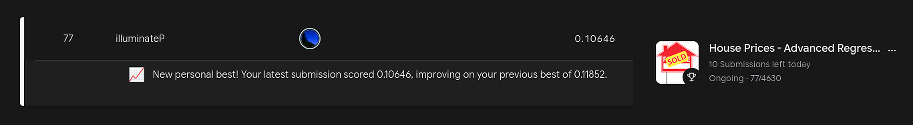
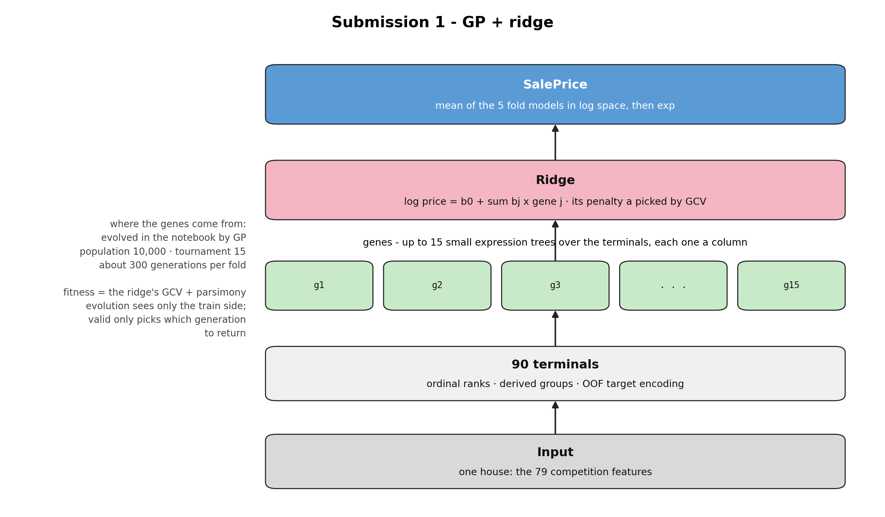
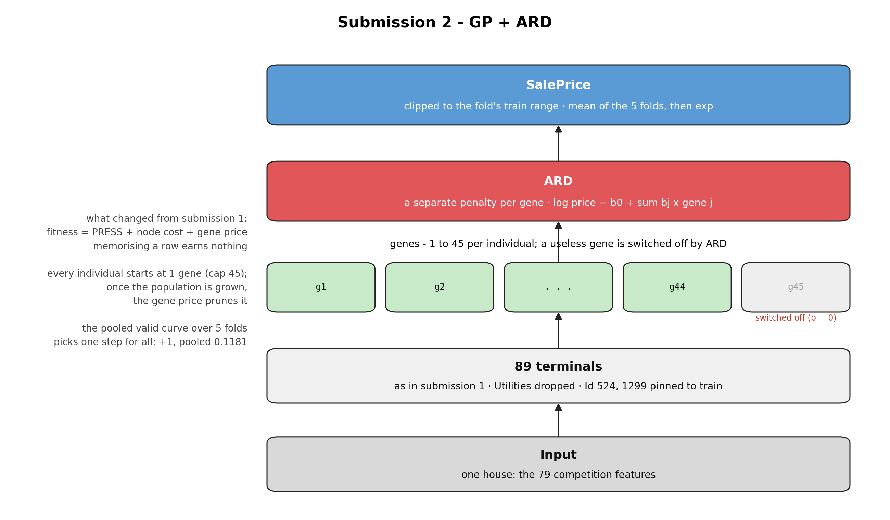
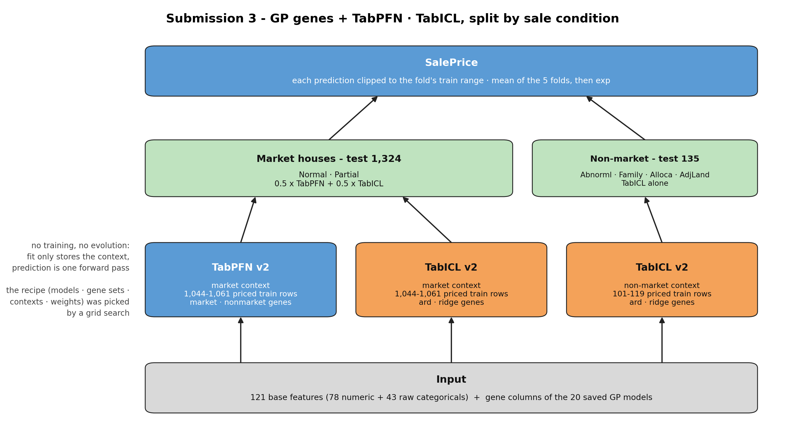
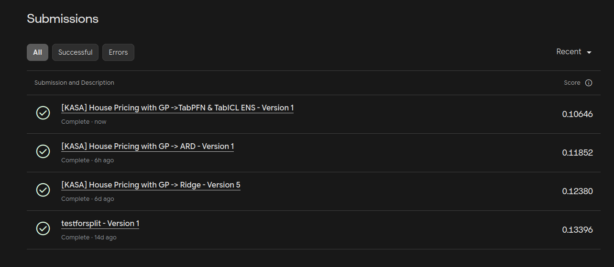
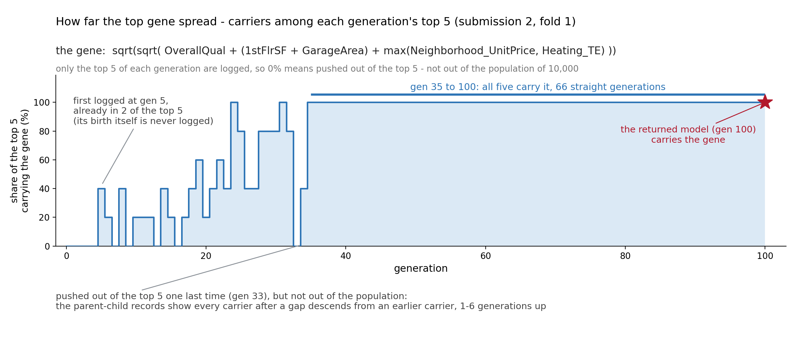

# GP Genes: 수식을 진화시켜 집값을 예측하는 House Prices 솔루션


**언어 / Language: 한국어 (아래) · [English](#english)**



> 유전 프로그래밍(GP)이 수식 피쳐를 진화시키고, 릿지 · ARD · 표 파운데이션 모델이 그 피쳐로 집값을 예측하는 Kaggle House Prices 솔루션 세 개를 만들었다.<br>
솔루션을 개선할 때마다 점수가 내려가, 원핫 릿지 기준선 0.13396에서 출발한 리더보드 RMSE가 0.10646이 됐다(2026-10-30 공개 리더보드 기준 4,630팀 중 77위).

---

## 소개

Kaggle의 [House Prices - Advanced Regression Techniques](https://www.kaggle.com/competitions/house-prices-advanced-regression-techniques)는 미국 Ames시 주택의 특성 79개로 집값을 맞히는 입문 대회다. 대회 부제부터 피쳐 엔지니어링과 그래디언트 부스팅을 연습하라고 안내하고, 가장 대중적인 풀이도 사람이 피쳐를 설계한 뒤 부스터나 선형 모델을 올린다.

문제는 모델이 사용할 만한 피쳐를 사람이 모두 생각해야 한다는 점이다. 예컨대 `log(GrLivArea(지상 생활 면적) × 동네 평당가)` 같은 열은 모델이 스스로 도출해내지 못한다. 릿지 회귀는 받은 열의 계수를 누르기만 하고 라쏘도 열을 끄기만 할 뿐, 어느 쪽도 새 열을 만들어 내지는 못한다. 실제로 범주형을 원핫으로 펼쳐 릿지에 넣은 기준선 제출(testforsplit)은 리더보드 RMSE [0.13396](assets/kaggle_submissions_2026-10-24.png)에서 멈췄다.

그래서 피쳐를 만드는 일을 유전 프로그래밍(GP, Genetic Programming)에 맡겼다. GP가 수식을 생물처럼 교배하고 변이시켜 피쳐가 될 수식(유전자)을 찾고, 그 열의 계수는 선형 결정자가 정한다. 이 분업을 세 제출로 발전시켰다.

- 대회 train에서 모순된 7행을 지운 1,453행을 5개 fold로 나눈 표를 만들어, 세 제출이 같은 분할을 쓰게 했다.
- 제출 1 **GP + 릿지** : GP가 유전자 1~15개를 진화시키고, 릿지가 GCV로 자기 벌점까지 골라 계수를 정한다. 적합도는 릿지의 GCV다.
- 제출 2 **GP + ARD** : 결정자를 유전자마다 벌점을 따로 두는 ARD로 바꾸고, 적합도를 외움에 점수를 주지 않는 PRESS로 바꿨다. 유전자 상한을 45로 풀고 유전자 가격으로 키운 뒤 깎는다.
- 제출 3 **GP 유전자 + TabPFN · TabICL 앙상블** : 저장해 둔 GP 모델 20개의 유전자를 열로 만들어 표 파운데이션 모델 둘에 주고, 판매 조건 축(시장 · 비시장)마다 다르게 섞는다. 진화는 다시 돌리지 않는다.
- 거래가 유독 특이한 두 채(Id 524 · 1299)는 모든 fold에서 train 쪽에 고정하고 valid에서 뺐다. valid에 들어가면 290행짜리 fold 점수를 혼자 흔들고, 아예 지우면 test에도 있는 같은 유형을 배울 수 없기 때문이다.

리더보드 RMSE는 기준선 0.13396에서 0.12380(제출 1), 0.11852(제출 2), 0.10646(제출 3)으로 내려갔다. 2026-10-30 기준 공개 리더보드에서 4,630팀 중 77위다.

선형 모델에서 출발한 GP 유전자가 선형 결정자만이 아니라 표 파운데이션 모델(TabPFN, TabICL)에도 보탬이 된다는 것을 같은 fold 위에서 확인했다. 유전자는 식과 계수만 담은 JSON 포맷이라, 같은 피쳐를 다른 결정자나 모델에 그대로 물릴 수 있다.

---

## 1. 문제

대회는 train 1,460채의 특성 79개와 가격을 주고, test 1,459채의 가격을 맞히게 한다. 특성은 면적 · 품질 등급 · 동네 · 판매 조건처럼 성격이 제각각이고, 그중 43개는 글자로 된 범주형이다.

| 항목 | 내용 |
|---|---|
| 과제 유형 | 회귀 (주택 가격) |
| 입력 | 주택 특성 79개 (수치 36 · 범주 43) |
| 출력 | test 1,459채의 `SalePrice` |
| 평가 지표 | log 가격의 RMSE (낮을수록 좋다) |
| 제약 | 마감 없는 입문 대회. 리더보드가 계속 갱신된다 |

지표가 log 눈금이라 비싼 집과 싼 집의 오차가 같은 비율로 벌점을 받는다. RMSE 0.1은 가격으로 10% 안팎의 오차에 해당한다. 기준선은 원핫 릿지의 0.13396이고, 이 저장소의 세 제출은 모두 그보다 낮다.
범주형 43열이 피쳐의 절반을 차지한다. 원핫으로 펼치면 열이 300개를 넘어 1,453행에 비해 지나치게 넓어지므로, 수준이 많은 범주는 타깃 인코딩[11](범주를 그 범주에 속한 집들의 평균 가격으로 바꾸는 것)으로 접었다. 처음에는 자기 행만 빼고 평균하는 LOO로 계산했지만 범주의 합에서 자기 가격이 역산되는 누수를 겪었고, 자기가 속하지 않은 내부 조각의 평균만 받는 OOF 방식으로 바꿨다(3.2절).

---

## 2. 배경 — 수식을 진화시키는 GP

### 2.1 GP가 무엇인가

유전 프로그래밍[1]은 수식을 나무로 적고, 그 나무의 집단을 생물처럼 진화시켜 데이터를 가장 잘 설명하는 수식을 찾는 방법이다. 나무의 잎은 데이터의 열(터미널)이고, 가지는 연산자다. 예컨대 `log(min(Neighborhood_UnitPrice, GrLivArea))`는 잎 둘과 연산자 둘로 된 나무 하나다. 연산자는 `+ − × ÷ log √ max min`의 8개를 쓰는데, 이 가운데 `÷ · log · √`는 0으로 나누거나 음수를 받아도 오류 대신 유한한 값을 내는 보호 연산자다. 무작위로 만든 수식이 계산 불능으로 죽지 않게 하기 위해서다.

한 세대는 네 단계로 돈다.

| 단계 | 하는 일 |
|---|---|
| 1 채점 | 개체마다 점수(적합도)를 매긴다. 그 나무들이 만든 열로 선형 결정자가 가격을 얼마나 잘 맞히는지 본다 |
| 2 선택 | 무작위로 15개를 뽑아 그중 가장 좋은 개체를 부모로 삼는다(토너먼트) |
| 3 번식 | 두 부모가 나무나 가지를 맞바꾸고(교차), 일부를 무작위로 바꾼다(돌연변이) |
| 4 교체 | 자식으로 다음 세대를 채운다. 1등은 손대지 않고 그대로 넘긴다(엘리트) |

이것을 수백 세대 반복하면 점수를 올리는 가지가 개체군에 퍼진다. 옵티마이저가 정해진 식의 가중치를 고치는 것과 달리, GP는 어떤 식을 남길지 고르므로 식의 모양과 쓰는 열까지 바뀐다.

### 2.2 가격까지 GP에게 맡기면 안 된다

처음 판(v1)은 나무 하나가 가격을 직접 내게 했다. 쓸 열과 식의 모양과 계수와 상수를 전부 진화로 찾아야 했고, 세 군데서 어긋났다. 같은 열을 릿지에 그대로 주면 valid RMSE가 0.12인데 GP는 train 오차가 0.14에 머물렀고, log 가격을 맞추는 데 꼭 필요한 상수 항은 가진 개체가 드물어 곧 사라졌으며(대신 거의 모든 행이 같은 값인 `KitchenAbvGr`를 상수처럼 썼다), 범주형 원핫 열은 거의 다 버려졌다. GP가 명목형 지시 변수를 제거하는 경향은 문헌에도 보고되어 있다[6]. v1은 제출하지 않았고, 이 판의 기록은 [제출 1 노트북](kasa-house-pricing-with-gp-ridge.ipynb)에서 확인할 수 있다.

### 2.3 다유전자 GP의 분업

그래서 개체 하나가 수식 나무 여러 그루(유전자)를 들고 다니는 다유전자 GP[2]로 바꿨다. 유전자 하나가 새 열 하나가 되고, 선형 결정자가 그 열들을 받아 절편과 계수를 정한다. 적합도는 결정자의 점수이므로 GP는 가격을 직접 맞히지 않고 결정자가 쓰기 좋은 재료를 만드는 쪽으로 진화한다.

| 풀이 | 무엇을 정하는가 | 평가 1회 단가 |
|---|---|---|
| 다유전자 GP | 어떤 열이 몇 개 존재할지 | — |
| 릿지 + GCV | 각 열의 비중, 그리고 자기 α | 0.37 ms |

이 분업이 돌아가는 것은 결정자가 싸기 때문이다. 릿지 한 번이 α 격자 6개를 다 풀어도 0.37ms라서, 개체 10,000개를 300세대에 걸쳐 채점할 수 있다. 같은 자리에 부스터를 앉히면 평가 단가가 227배가 되고, TabPFN 같은 트랜스포머를 앉히는 안은 같은 예산을 GPU 한 장으로 38~191일 돌려야 해서 계산해 보는 단계에서 접었다.

이 구조에서는 경쟁이 세 층에서 일어난다. 개체(유전자 묶음)끼리는 15개 중 1등만 부모가 되는 토너먼트에서 자리를 다투고, 개체 안에서는 유전자(수식)끼리 결정자가 나눠 주는 계수와 크기 벌점을 두고 다투며, 수식 안에서는 항(피쳐)끼리 식의 자리를 두고 다툰다. 어느 층에서든 점수에 보탬이 되지 않는 쪽이 밀려난다. 실제로 무엇이 살아남았는지는 5.4절에서 센다.

---

## 3. 데이터

### 3.1 분할

| | train | fold별 valid | test |
|---|---:|---:|---:|
| 행 수 | 1,453 | 290~291 | 1,459 |

train 1,460행 가운데 7행(Id 625 · 689 · 774 · 1231 · 1242 · 1301 · 1335)은 지하실 유형은 '없음'인데 지하실 면적은 있는 식으로 값끼리 모순되어 지웠다. 남은 1,453행을 5개 fold([`bundle/folds.csv`](bundle/folds.csv), 크기 291 · 291 · 291 · 290 · 290)로 나눴고, 세 노트북이 같은 표를 읽는다. fold마다 나머지 네 fold가 train, 자기 fold가 valid가 되고, 제출물은 다섯 fold 모델의 예측을 log 공간에서 평균한 것이다.

### 3.2 전처리

**모순 수정** : train 7행은 지우고, test의 모순 6칸은 값을 바로잡는다. test는 행을 지울 수 없기 때문이다.

**범주형 43열** : 세 갈래로 바꾼다. 품질 등급처럼 순서가 있는 23열은 정수 순서(`Ex`=5 … `Po`=1)로, 외장재처럼 수준이 많은 9열은 도메인 묶음으로 만든 파생 21열로(동네는 평당가 1열로), 순서가 없는 11열은 타깃 인코딩(범주를 그 범주에 속한 집들의 평균 가격으로 바꾸는 것)으로 넣는다. 타깃 인코딩은 자기 행만 빼는 LOO가 아니라 OOF(out-of-fold, 행을 내부 5조각으로 나눠 자기가 속하지 않은 4조각의 평균을 주는 것)로 계산한다. LOO가 버려진 계기는 4.1절에 있다.

**이상치 두 채** : Id 524와 1299는 4,676 · 5,642sqft의 큰 집이 신축 분양 거래로 184,750 · 160,000달러에 팔린 행이다. 제출 2와 3은 이 두 채를 모든 fold에서 train 쪽에 고정하고 가격 통계에서는 뺀다. valid에 들어가면 점수를 흔들고, 빼 버리면 test에 있는 같은 유형을 배울 수 없기 때문이다.

**설계행렬** : 위 전처리를 거치면 GP가 읽는 터미널이 제출 1에서 90열이다. 제출 2부터는 train의 한 집만 값이 다른 `Utilities`를 빼서 89열이 된다. 그 열로 배울 수 있는 것이 그 한 집을 짚어 내는 법뿐이기 때문이다.

---

## 4. 제출 1 — GP + 릿지

### 4.1 설계

개체 하나는 터미널 90개 위의 유전자 1~15개를 들고 있다. 평가 때마다 유전자를 열로 계산해 릿지에 주고, 릿지는 GCV가 가장 낮은 α를 격자에서 골라 계수를 정한다. GCV[3]는 한 행을 빼고 맞춘 오차를 계산 한 번으로 어림하는 값이라, valid를 쓰지 않고도 일반화를 가늠하게 해 준다. 적합도는 이 GCV에 크기 절약 벌점을 더한 값이다.



*그림 1. 제출 1의 모델. 집 한 채의 79개 특성이 터미널 90열이 되고, GP가 진화시킨 유전자 최대 15개가 열이 되어 릿지가 가격을 낸다. 진화 절차는 그림 왼쪽 주석과 본문에 있다.*

| 항목 | 값 | 항목 | 값 |
|---|---|---|---|
| 개체군 | fold마다 10,000 | 세대 | 300 |
| 유전자 수 | 1~15 (가변) | 선택 | 토너먼트 15, 엘리트 1 |
| 적합도 | 릿지 GCV + 절약 벌점 | 반환 | fold마다 valid가 가장 낮은 세대의 1등 |

진화는 train 쪽 점수(GCV 적합도)만 보고 돈다. valid는 세대마다 1등을 한 번 채점해 두었다가, 어느 세대의 모델을 돌려줄지 고르는 데에만 쓴다.

LOO 타깃 인코딩을 버린 계기도 GP였다. LOO는 범주의 합에서 자기 행의 가격이 역산되는 구조인데(1절), 개발 중의 진화가 그 역산식을 실제로 찾아내 train 오차가 0.003까지 떨어지는 외움이 나왔다. 평균을 자기가 속하지 않은 내부 조각으로만 받는 OOF로 바꾸자 복원할 길이 사라졌고, 수식 전개는 [제출 1 노트북](kasa-house-pricing-with-gp-ridge.ipynb) 3절에 적어 두었다.

### 4.2 결과

**fold별 valid RMSE — GP + 릿지 대 같은 설계행렬 90열을 그대로 받은 릿지**

| | fold 0 | fold 1 | fold 2 | fold 3 | fold 4 | **평균** |
|---|---:|---:|---:|---:|---:|---:|
| 릿지 90열 | **0.1380** | 0.1879 | 0.1513 | 0.1244 | 0.1198 | 0.1443 |
| GP + 릿지 | 0.1392 | **0.1488** | **0.1261** | **0.1207** | **0.1061** | **0.1282** |
| 차이 | +0.0013 | −0.0391 | −0.0252 | −0.0038 | −0.0137 | −0.0161 |

같은 재료를 받은 릿지가 기준이므로, 평균 −0.0161은 유전자 9~15개가 원래 열 90개보다 더 많은 것을 담았다는 뜻이다. 리더보드 RMSE는 0.12380으로 원핫 기준선보다 0.0102 낮고, 실행은 Kaggle CPU 4코어에서 3.4시간이다.

---

## 5. 제출 2 — GP + ARD

### 5.1 결정자는 ARD로, 적합도는 PRESS로

릿지는 벌점 α 하나로 모든 유전자를 같은 세기로 누른다. ARD(Automatic Relevance Determination)[4]는 유전자마다 벌점 α_j를 따로 두고 데이터가 그럴듯해지는 쪽으로 맞추므로, 쓸모없는 유전자는 벌점이 한없이 커져 계수가 정확히 0이 되고(꺼짐) 쓸모 있는 유전자는 거의 누르지 않는다. 모든 α_j가 같으면 릿지이므로, 릿지는 ARD의 특수한 경우다.

적합도는 GCV에서 PRESS[5]로 바꿨다. GCV는 행마다 다른 레버리지를 평균 하나로 어림하기 때문에, 한 행을 통째로 외운 유전자의 오차 0을 잘 맞혔다고 센다. PRESS는 한 행을 빼고 맞춘 식으로 그 행을 예측한 오차를 그대로 재므로, 외워서는 점수가 오르지 않는다. 적합도는 PRESS + 1e-5 × 노드 수 + 유전자 가격 × 살아 있는 유전자 수다.



*그림 2. 제출 2의 모델. 제출 1과 같은 뼈대에서 터미널이 89열이 되고 결정자가 ARD로 바뀌어, 값을 못 하는 유전자는 계수 0으로 꺼진다. 왼쪽 주석이 제출 1에서 바뀐 점이다.*

### 5.2 유전자를 불렸다가 덜어 내고, 돌려줄 세대는 valid가 고른다

모든 개체가 유전자 1개로 출발하고 상한은 45다. 평균 유전자 수가 10세대 동안 멈추면 다 자랐다고 보고(이 실행은 fold마다 세대 49~99에서 판정), 그때부터 유전자 가격을 250세대에 걸쳐 0에서 0.003까지 올린다. 값을 못 하는 유전자부터 떨어져 나간다. 돌려줄 모델은 다섯 fold의 valid 오차를 합친 곡선이 가장 낮은 지점으로 고른다. fold 하나(290행)로 고르면 잡음을 고르게 되기 때문인데, 이 실행은 판정 뒤 +1세대를 골랐고 그때의 통합 valid가 0.1181이다.

처음 보는 행에서 어긋나지 않게 막는 장치도 함께 넣었다. valid · test 행의 유전자 값은 그 유전자가 train에서 낸 범위로 자르고, 예측값은 그 fold의 train log 가격 범위로 자른다. `Utilities` 열 제거와 이상치 두 채의 train 고정은 3절에 적은 대로다.

### 5.3 결과

**fold별 valid RMSE — GP + ARD 대 같은 설계행렬 89열을 그대로 받은 릿지**

| | fold 0 | fold 1 | fold 2 | fold 3 | fold 4 | **평균** |
|---|---:|---:|---:|---:|---:|---:|
| 릿지 89열 | **0.1384** | 0.1329 | 0.1293 | 0.1237 | 0.1208 | 0.1290 |
| GP + ARD | 0.1388 | **0.1151** | **0.1141** | **0.1187** | **0.1006** | **0.1174** |
| 차이 | +0.0004 | −0.0178 | −0.0152 | −0.0050 | −0.0202 | −0.0116 |

돌려준 모델에서는 ARD가 fold마다 유전자 2~10개를 껐고, 살아 있는 유전자가 33~45개다. 리더보드 RMSE는 0.11852로 제출 1보다 0.0053 낮고, 실행은 Kaggle CPU 4코어에서 10.0시간이다.

### 5.4 어떤 유전자가 뽑혔나

진화가 실제로 남긴 식을 기록으로 셀 수 있다. 제출 2는 세대마다 상위 5개 개체의 유전자를 출력의 기록 묶음(`viz_records.zip`)에 남기고, 다섯 fold의 기록 전체에는 고유한 유전자 4,552개가 161,791번 등장한다. 가장 많이 등장한 10개가 아래 표다. 터미널은 전처리에서 눈금을 맞춘 값(0은 0 그대로)이라 식은 달러가 아니라 그 눈금 위에서 읽고, 열 개 모두 주로 등장한 fold의 반환 모델까지 살아남았다.

| 순위 | 유전자 (기록 그대로) | 등장 | 해석 |
|---|---|---|---|
| 1 | `sqrt(sqrt(add(OverallQual, add(add(1stFlrSF, GarageArea), max(Neighborhood_UnitPrice, Heating_TE)))))` | 1,495회 · fold 1 · 4 | 품질과 1층 · 차고 면적의 합에 max(동네 평당가, 난방 TE)를 더해 4제곱근으로 누른 크기 · 품질 · 동네 합성 지표 |
| 2 | `add(max(sqrt(OpenPorchSF), GrLivArea), add(GarageCars, Neighborhood_UnitPrice))` | 1,476회 · fold 2 | 거실 면적(작으면 √베란다가 대신 선다) + 차고 대수 + 동네 평당가 |
| 3 | `sqrt(sqrt(add(OverallQual, add(add(1stFlrSF, GarageArea), max(Neighborhood_UnitPrice, add(1stFlrSF, SaleCondition_TE))))))` | 1,465회 · fold 1 | 1위의 변형. max 안쪽이 동네 평당가 대 1층 면적 + 판매 조건 TE |
| 4 | `sqrt(sqrt(add(max(FullBath, CentralAir), add(add(1stFlrSF, GarageArea), MSZoning_TE))))` | 1,430회 · fold 2 | max(욕실 수, 중앙 냉방)에 1층 · 차고 면적과 용도지역 TE를 더해 누른 꼴 |
| 5 | `sqrt(sqrt(add(add(log(LotArea), OverallQual), add(add(1stFlrSF, SaleCondition_TE), add(2ndFlrSF, YearBuilt)))))` | 1,428회 · fold 1 | log 대지 · 품질 · 1층과 2층 면적 · 건축 연도 · 판매 조건 TE의 넓은 합 |
| 6 | `sqrt(sub(Neighborhood_UnitPrice, add(sqrt(mul(BsmtQual, add(GarageArea, Heating_TE))), Condition_Road)))` | 1,407회 · fold 2 | 동네 평당가에서 지하 품질 · 차고 · 난방 항과 도로 인접을 빼는 보정식 |
| 7 | `mul(add(log(LotArea), OverallQual), Neighborhood_UnitPrice)` | 1,378회 · fold 3 | (log 대지 면적 + 품질) × 동네 평당가. 크기와 품질을 동네 시세로 환산한다 |
| 8 | `add(Functional, SaleCondition_TE)` | 1,331회 · fold 0 · 3 | 기능성 등급 + 판매 조건 TE의 선형 합. 제출 3이 이 축을 앙상블로 키운다 |
| 9 | `sqrt(sqrt(add(max(sqrt(LotConfig_Frontages), add(CentralAir, TotalBsmtSF)), add(add(1stFlrSF, GarageArea), max(Neighborhood_UnitPrice, KitchenQual)))))` | 1,316회 · fold 1 | 1위 계열. 중앙 냉방 + 지하 면적과 주방 품질이 들어온 변형 |
| 10 | `add(add(mul(OverallCond, GrLivArea), PoolQC), mul(BsmtQual, BsmtFinSF1))` | 1,284회 · fold 0 | 상태 × 거실 면적 + 지하 품질 × 지하 마감 면적 + 수영장 품질 |

오래 1등 자리에 있던 식이 곧 끝까지 가는 식이다. 재료도 몇 가지가 돌려 쓰인다. `1stFlrSF + GarageArea`의 크기 합, 동네 평당가, 판매 조건 TE가 서로 다른 식에 거듭 나타나고, 큰 값을 누르는 `sqrt(sqrt(...))`와 `log`가 다섯 식에 들어 있다.

2.3절에서 말한 세 층의 경쟁이 수치로도 보인다. 반환 모델 다섯 개의 살아 있는 유전자 210개는 터미널 89개 중 79개를 쓰는데 비중은 크게 쏠려서, GrLivArea가 유전자 61개, OverallQual이 52개, 동네 평당가가 37개, 1stFlrSF가 35개, 판매 조건 TE가 28개에 들어 있다. 연산자 점유도 세대가 가며 바뀌어, 처음에 12% 안팎으로 고르던 것이 마지막 세대에는 add 35~44%로 늘고 div는 0~5%로 줄었다. 수식도, 수식 속의 항도 자리를 두고 경쟁한 결과다.

---

## 6. 제출 3 — GP 유전자 + TabPFN · TabICL 앙상블

### 6.1 전문가 셋과 판매 조건 축

제출 3은 진화를 다시 돌리지 않는다. 같은 재료(89열 설계행렬) 위에서 미리 진화시켜 번들에 저장해 둔 GP 모델 20개(ard · ridge와, 시장 거래 행만으로 진화한 market · 비시장 행만으로 진화한 nonmarket의 4런 × 5 fold)에서 살아 있는 유전자를 열로 계산해, 기본 피쳐 121열(수치 78 + 원시 범주 43)에 붙인다. 계수는 쓰지 않고 유전자 값만 넣어, 조합은 받는 모델에게 맡긴다.

받는 모델은 표 파운데이션 모델 둘이다. TabPFN v2[8]와 TabICL v2[9]는 합성 데이터로 만든 수많은 표로 미리 학습한 트랜스포머로, 가격이 붙은 train 행을 컨텍스트로 넣으면 가중치 학습 없이 예측할 행 전부의 가격 분포를 한 번에 낸다(in-context learning).

판매 조건은 집값이 정해지는 방식을 가른다. 압류 · 급매 · 가족 간 거래 같은 비시장 거래는 train의 9%인데 가격 규칙이 보통 거래와 다르다. 그래서 fold마다 전문가 셋을 두고 축마다 다르게 섞는다. 이 조합(모델 · 유전자 · 컨텍스트 · 섞는 비율)은 그리드 서치로 골랐다.

| 행 (test / valid) | 전문가와 섞기 |
|---|---|
| 시장 거래 1,324 / 1,314 (Normal · Partial) | 0.5 × TabPFN(market · nonmarket 유전자, 시장 컨텍스트) + 0.5 × TabICL(ard · ridge 유전자, 시장 컨텍스트) |
| 비시장 거래 135 / 137 (Abnorml · Family · Alloca · AdjLand) | TabICL(ard · ridge 유전자, 비시장 컨텍스트) 단독 |



*그림 3. 제출 3의 모델. 기본 피쳐 121열에 저장된 GP의 유전자 열을 붙여 전문가 셋에 주고, 집의 판매 조건이 누구의 예측을 쓸지 정한다.*

두 모델의 사전학습 가중치는 실행할 때마다 공식 저장소(`Prior-Labs/TabPFN-v2-reg` 44.4 MB · `jingang/TabICL` 114.3 MB)에서 받아 고정해 둔 SHA-256과 대조하고, 출력에는 넣지 않는다.

### 6.2 결과

**축별 valid RMSE (1,451행, 다섯 fold 합산)**

| valid 행 | TabPFN 시장 | TabICL 시장 | TabICL 비시장 | **섞은 뒤** |
|---|---:|---:|---:|---:|
| 시장 거래 (1,314) | 0.0961 | 0.0958 | — | **0.0938** |
| 비시장 거래 (137) | — | — | 0.2066 | 0.2066 |
| 전체 (1,451) | | | | **0.1095** |

노트북은 계산한 유전자 값에 각 GP의 계수를 곱해 저장된 valid 점수를 재현하는지도 확인하는데, 가장 큰 차이가 2.9e-15라 번들 · 전처리 · 수식 평가기가 원본과 같다는 증거가 된다. 리더보드 RMSE는 0.10646으로 제출 2보다 0.0121 낮고, 실행은 Kaggle T4에서 약 3분이다(전문가 예측 15회가 2.1분).

---

## 7. 결과



*그림 4. Kaggle 제출 기록. 기준선부터 제출 3까지 네 번의 점수가 한 화면에 있다.*

| 제출 | 구성 | 리더보드 RMSE | 기준선 대비 |
|---|---|---:|---:|
| 기준선 (testforsplit) | 원핫 + 릿지 | 0.13396 | |
| 제출 1 | GP + 릿지 | 0.12380 | −0.0102 |
| 제출 2 | GP + ARD | 0.11852 | −0.0154 |
| **제출 3** | GP 유전자 + TabPFN · TabICL | **0.10646** | **−0.0275** |

2026-10-30 공개 리더보드 순위는 4,630팀 중 77위다(맨 위 그림).

---

## 8. 결론

같은 fold 표 위에서 피쳐를 만드는 쪽은 GP로 고정한 채 받는 쪽을 릿지, ARD, 표 파운데이션 모델로 바꿀 때마다 리더보드 RMSE가 내려가 기준선보다 0.0275 낮아졌다. 받는 모델이 무엇이든 같은 재료를 그대로 받은 비교선(릿지 90열 0.1443 → GP + 릿지 0.1282, 릿지 89열 0.1290 → GP + ARD 0.1174)을 이겼으므로, 점수를 낮춘 몫은 유전자에 있다. 크기로 보면, 제출 1은 fold마다 유전자 9~15개로 원핫 301열을 받은 기준선 릿지를 이겼다.

부스터와의 앙상블은 채택하지 않았다. 제출 2의 잔차에 부스터 4종(AdaBoost · GBM · XGBoost · CatBoost)을 붙여 보면 나무 몇 그루 만에 조기 종료가 걸리고 보정이 거의 0이었다. 곱과 같은 비선형 항을 GP가 이미 열로 만들어 넣어 부스터가 주울 것이 남지 않았고, 둘은 같은 집을 같은 방향으로 틀린다. 반면 같은 유전자를 TabPFN · TabICL에 피쳐로 주자 리더보드가 0.11852에서 0.10646으로 내려갔다(제출 3). 선형 결합은 한 식을 모든 집에 똑같이 적용하지만, 두 모델은 예측할 집마다 train의 집들과 어텐션(행끼리 서로를 참조하는 계산)으로 비슷한 집의 가격을 빌려 온다. 유전자가 만든 열이 '비슷한 집'을 고르는 좌표로 쓰였다.

유전자가 선형 모델 밖에서도 통한 이유는 적합도 설계에 있다. PRESS는 한 행을 빼고 맞춘 오차를 그대로 재므로 행을 외워서는 점수가 오르지 않고, 유전자 가격은 노는 유전자에게 자릿세를 물린다. 그래서 진화가 행을 외우는 쪽이 아니라 정보를 늘리는 쪽으로 갔고, 5.4절의 표처럼 오래 살아남은 식은 전부 크기 · 품질 · 동네 · 판매 조건을 조합한 일반 규칙이다. 그림 5가 이 유전자의 세대별 퍼짐이다. 기록은 세대마다 상위 5개체뿐이라 그 안의 비율로 세면, 유전자는 늦어도 세대 5에 태어나 다섯 중 둘의 몸에서 처음 기록에 잡히고, 초반에는 상위 5위 밖으로 밀려나기를 거듭하다가(마지막은 세대 33), 세대 35부터 반환 세대(100)까지 66세대 동안 다섯 모두가 가진 채 내려온다. 0%가 소멸은 아니다. 부모-자식 기록을 따라가면 공백 뒤의 보유 개체가 전부 1~6세대 위 이전 보유 개체의 후손이라, 유전자는 상위권 밖에서도 개체군에 살아 있었다. 한 행을 외운 식이었다면 PRESS가 점수를 주지 않아 이렇게 오래 남지 못한다.



*그림 5. 세대별 상위 5개체 중 1위 유전자를 가진 비율(제출 2 fold 1). 0%는 상위 5위 밖으로 밀렸다는 뜻이지 소멸이 아니고, 세대 35부터는 다섯 모두가 가진 채 반환 모델(별)까지 간다.*

끝으로 리더보드의 간극을 설명하자면, 이 대회의 test 정답은 공개된 Ames 원본 데이터[7]에서 복원할 수 있어서, 리더보드 맨 앞에는 일반적으로 도달하기 어려운 0.044 이하의 점수가 73팀 줄지어 있다. 모델의 예측 성능으로 보기는 어려운 구간이다. 대회 discussion에서도 여러 차례 지적된 내용이다. 그 구간을 빼고 세면 이 제출은 네 번째라고 할 수 있다(2026-10-30 기준).

---

## 저장소 구조

폴더는 역할별이고, `bundle/`은 Kaggle 데이터셋 hp-bundle의 배치를 그대로 따른다.

```
.
├── kasa-house-pricing-with-gp-ridge.ipynb               제출 1 — GP + 릿지 (Kaggle 실행본, 출력 포함)
├── kasa-house-pricing-with-gp-ard.ipynb                 제출 2 — GP + ARD (Kaggle 실행본, 출력 포함)
├── kasa-house-pricing-with-gp-tabpfn-tabicl-ens.ipynb   제출 3 — 앙상블 (Kaggle 실행본, 출력 포함)
├── bundle/                                              노트북이 읽는 입력 (Kaggle 데이터셋 hp-bundle과 같다)
│   ├── folds.csv                                        train 1,453행의 Id와 fold 번호
│   └── gp_{run}_fold{f}.json                            저장된 GP 모델 20개 (ard · ridge · market · nonmarket × fold 0~4)
├── assets/                                              README 그림 (제출별 모델 그림 · 1위 유전자 이력 · Kaggle 스크린샷)
├── LICENSE                                              MIT
└── .gitignore                                           대회 데이터와 실행 산출물을 올리지 않는다
```

| 경로 | 역할 |
|---|---|
| [`kasa-house-pricing-with-gp-tabpfn-tabicl-ens.ipynb`](kasa-house-pricing-with-gp-tabpfn-tabicl-ens.ipynb) | 최종 제출(0.10646). 번들의 GP 20개를 읽어 앙상블만 돌린다. 이 저장소의 핵심 |
| [`kasa-house-pricing-with-gp-ard.ipynb`](kasa-house-pricing-with-gp-ard.ipynb) | GP 구현과 진화 전체가 이 노트북 안에서 돈다. 번들의 GP 모델은 같은 재료로 미리 돌린 런의 것이다 |
| [`kasa-house-pricing-with-gp-ridge.ipynb`](kasa-house-pricing-with-gp-ridge.ipynb) | 첫 분업 판. v1의 실패 기록과 LOO 누수의 수식이 0절 · 3절에 있다 |
| [`bundle/folds.csv`](bundle/folds.csv) | 세 노트북이 공유하는 분할. Id와 fold 번호만 담는다 |
| `bundle/gp_*.json` | 유전자 식 · 결정자 해 · 클리핑 범위. 제출 3이 읽고, 식은 사람이 그대로 읽을 수 있다 |

노트북을 돌리면 작업 폴더(Kaggle은 `/kaggle/working`)에 `submission.csv`와 기록 묶음 `viz_records.zip`, 중간 산출물 `outputs/`가 생긴다.

---

## 재현

### 환경

세 제출 모두 Kaggle 노트북에서 실행했다. 아래 제출본 페이지에서 Copy & Edit 하면 대회 데이터와 입력 데이터셋이 함께 붙으므로 그대로 실행하면 된다.

| 제출 | Kaggle 제출본 | 리더보드 RMSE |
|---|---|---:|
| 1 | [GP + 릿지](https://www.kaggle.com/code/illuminatep/kasa-house-pricing-with-gp-ridge) | 0.12380 |
| 2 | [GP + ARD](https://www.kaggle.com/code/illuminatep/kasa-house-pricing-with-gp-ard) | 0.11852 |
| 3 | [GP 유전자 + TabPFN & TabICL 앙상블](https://www.kaggle.com/code/illuminatep/kasa-house-pricing-with-gp-tabpfn-tabicl-ens) | **0.10646** |

입력 데이터셋은 [hp-bundle](https://www.kaggle.com/datasets/illuminatep/hp-bundle)이고, 이 저장소의 [`bundle/`](bundle/)과 같은 파일이다. 아래는 로컬에서 돌릴 때의 준비다.

```bash
git clone <repository-url>
cd <repository>

# 제출 1 · 2 (CPU · Python 3, numpy 2.1 · pandas 2.3 · scikit-learn · deap)
pip install jupyterlab numpy pandas scikit-learn deap
```

제출 3은 위에 더해 GPU torch와 tabpfn 9.2.0 · tabicl 2.2.0이 필요하고, 가중치를 받을 인터넷 연결이 있어야 한다(노트북 1절이 두 패키지를 설치한다).

### 1단계 — 대회 데이터 받기

| 자원 | 확보 방법 | 놓는 곳 |
|---|---|---|
| 대회 데이터 | [대회 페이지](https://www.kaggle.com/competitions/house-prices-advanced-regression-techniques)에서 규칙에 동의한 뒤 받는다 | `hidden/` |
| fold 표 · GP 모델 | 이 저장소의 [`bundle/`](bundle/)에 이미 있다 (Kaggle에서는 데이터셋 [hp-bundle](https://www.kaggle.com/datasets/illuminatep/hp-bundle)) | `bundle/` |

```bash
kaggle competitions download -c house-prices-advanced-regression-techniques -p hidden
unzip hidden/house-prices-advanced-regression-techniques.zip -d hidden    # train.csv · test.csv · sample_submission.csv
```

### 2단계 — 노트북 실행

```bash
HP_COMP_DIR=hidden HP_SPLIT_DIR=bundle \
jupyter lab kasa-house-pricing-with-gp-ridge.ipynb             # 제출 1 · CPU 4코어에서 3.4시간

HP_COMP_DIR=hidden HP_SPLIT_DIR=bundle \
jupyter lab kasa-house-pricing-with-gp-ard.ipynb               # 제출 2 · CPU 4코어에서 10.0시간 (조기 종료 없이 가지치기를 끝까지 돌고 고르므로 느리다)

HP_COMP_DIR=hidden HP_BUNDLE_DIR=bundle \
jupyter lab kasa-house-pricing-with-gp-tabpfn-tabicl-ens.ipynb # 제출 3 · T4에서 약 3분 (진화가 없어 빠르다)
```

커널을 다시 시작해 모든 셀을 끝까지 실행한다(Kernel → Restart Kernel and Run All Cells). 환경변수는 입력 위치를 알려 주는 값으로, 지정하지 않으면 노트북은 자기 옆에서 입력을 찾고, `/kaggle/input`이 있으면 Kaggle로 판단해 환경변수 없이 입력을 스스로 찾는다. 진화는 세대마다 기록을 남기므로 제출 1 · 2는 중간 출력으로 진행을 볼 수 있다.

### 3단계 — 결과 확인

각 노트북의 8절(점수 문턱)이 이번 실행의 valid 점수를 기록과 대조해 출력한다. 제출 1은 평균 valid 0.1282, 제출 2는 0.1174, 제출 3은 합친 valid 0.1095가 기록이고, 문턱(제출 1 · 2는 0.01, 제출 3은 0.002)을 넘으면 노트북이 멈추고 제출 파일을 쓰지 않는다.

```bash
head -3 submission.csv        # Id, SalePrice 1,459행
ls outputs/                   # 그림 재료 (viz_records.zip으로도 묶인다)
```

---

## 출처 및 라이선스

- **이 저장소의 코드와 번들** : MIT ([`LICENSE`](LICENSE)). `bundle/`의 fold 표와 GP 모델은 직접 만든 것이고, Kaggle 데이터셋 [hp-bundle](https://www.kaggle.com/datasets/illuminatep/hp-bundle)로도 공개되어 있다.
- **대회 데이터** : Kaggle [House Prices - Advanced Regression Techniques](https://www.kaggle.com/competitions/house-prices-advanced-regression-techniques). 대회 페이지에서 받으며 이 저장소에는 넣지 않았다. 원본은 공개된 Ames 주택 데이터[7]다.
- **TabPFN v2 가중치** : [`Prior-Labs/TabPFN-v2-reg`](https://huggingface.co/Prior-Labs/TabPFN-v2-reg), Prior Labs License 1.1. 제출 3이 실행 중에 받아 SHA-256을 대조하며 재배포하지 않는다. Built with PriorLabs-TabPFN.
- **TabICL v2 가중치** : [`jingang/TabICL`](https://huggingface.co/jingang/TabICL), BSD-3-Clause. 같은 방식으로 받고 재배포하지 않는다.
- **라이브러리** : GP는 [DEAP](https://github.com/DEAP/deap)[10] (LGPL-3.0), 그 밖에 numpy · pandas · scikit-learn · torch를 쓴다.

## 참고문헌

1. Koza JR. *Genetic Programming: On the Programming of Computers by Means of Natural Selection.* MIT Press (1992).
2. Searson DP, Leahy DE, Willis MJ. "GPTIPS: An Open Source Genetic Programming Toolbox for Multigene Symbolic Regression." *Proceedings of the International MultiConference of Engineers and Computer Scientists* (2010).
3. Golub GH, Heath M, Wahba G. "Generalized Cross-Validation as a Method for Choosing a Good Ridge Parameter." *Technometrics* 21.2 (1979): 215-223.
4. MacKay DJC. "Bayesian Interpolation." *Neural Computation* 4.3 (1992): 415-447.
5. Allen DM. "The Relationship Between Variable Selection and Data Augmentation and a Method for Prediction." *Technometrics* 16.1 (1974): 125-127.
6. Kronberger G, Kommenda M, Promberger A, Nickel F. "Predicting Friction System Performance with Symbolic Regression and Genetic Programming with Factor Variables." *Proceedings of the Genetic and Evolutionary Computation Conference (GECCO)* (2018).
7. De Cock D. "Ames, Iowa: Alternative to the Boston Housing Data as an End of Semester Regression Project." *Journal of Statistics Education* 19.3 (2011).
8. Hollmann N, Müller S, Purucker L, et al. "Accurate Predictions on Small Data with a Tabular Foundation Model." *Nature* 637 (2025): 319-326.
9. Qu J, Holzmüller D, Varoquaux G, Le Morvan M. "TabICL: A Tabular Foundation Model for In-Context Learning on Large Data." *Proceedings of the 42nd International Conference on Machine Learning (ICML)* (2025).
10. Fortin F-A, De Rainville F-M, Gardner M-A, Parizeau M, Gagné C. "DEAP: Evolutionary Algorithms Made Easy." *Journal of Machine Learning Research* 13 (2012): 2171-2175.

<br/>

---
---

<a id="english"></a>

# GP Genes: Evolving Formula Features for House Prices

> We built three Kaggle House Prices solutions in which genetic programming (GP) evolves formula features, and a ridge, an ARD and tabular foundation models price the houses with those features. Every improvement lowered the score: starting from the one-hot ridge baseline of 0.13396, the leaderboard RMSE ended at 0.10646, 77th of 4,630 teams on the public leaderboard as of 2026-10-30.

**Language: [한국어 (top)](#gp-genes-수식을-진화시켜-집값을-예측하는-house-prices-솔루션) · English (below)**

## Introduction

Kaggle's [House Prices - Advanced Regression Techniques](https://www.kaggle.com/competitions/house-prices-advanced-regression-techniques) is a getting-started competition: predict house prices in Ames, Iowa from 79 features. The competition subtitle itself tells you to practice feature engineering and gradient boosting, and the most popular solutions do exactly that: features designed by hand, then a booster or a linear model on top.

The catch is that a person has to think of every useful feature. A column like `log(above-ground living area GrLivArea × neighborhood unit price)` is nothing a model derives on its own: a ridge only shrinks the coefficients of the columns it is handed, a lasso only switches columns off, and neither ever writes a new one. Our baseline submission (testforsplit), a ridge over one-hot encodings, stopped at a leaderboard RMSE of [0.13396](assets/kaggle_submissions_2026-10-24.png).

So we handed the feature-writing job to genetic programming (GP). GP breeds and mutates formulas like organisms, searching for expressions (genes) that become feature columns, while a linear decider sets their coefficients. Three submissions grew out of this division of labor.

- We removed 7 self-contradictory rows from the competition train set and split the remaining 1,453 rows into 5 folds, shared by all three submissions.
- Submission 1, **GP + ridge**: the GP evolves 1–15 genes per individual; a ridge picks its own penalty by GCV and sets the coefficients. The fitness is the ridge's GCV.
- Submission 2, **GP + ARD**: the decider becomes an ARD with a separate penalty per gene, and the fitness becomes PRESS, which pays nothing for memorization. The gene cap rises to 45; a gene price grows the population first and prunes it after.
- Submission 3, **GP genes + TabPFN · TabICL ensemble**: the genes of 20 saved GP models become columns for two tabular foundation models, mixed differently on each sale-condition axis (market vs non-market). No evolution is re-run.
- Two houses with highly unusual sales (Id 524 · 1299) are pinned to the train side of every fold and kept out of valid: inside a 290-row validation fold they would swing the score by themselves, and dropping them entirely would unlearn a pattern that test also contains.

The leaderboard RMSE went from the 0.13396 baseline to 0.12380 (submission 1), 0.11852 (submission 2) and 0.10646 (submission 3), which stands 77th of 4,630 teams on the public leaderboard as of 2026-10-30.

GP genes that were evolved against a linear decider also helped tabular foundation models (TabPFN, TabICL), on the same fold table. Each gene is a small JSON of an expression and its solution, so the same features can be plugged into other deciders or models as they are.

## 1. Problem

The competition provides 79 features and the price for 1,460 training houses, and asks for the price of 1,459 test houses. The features are heterogeneous — areas, quality grades, neighborhood, sale condition — and 43 of them are text categoricals.

| Item | Detail |
|---|---|
| Task type | Regression (house price) |
| Input | 79 house features (36 numeric · 43 categorical) |
| Output | `SalePrice` for 1,459 test houses |
| Metric | RMSE of log price (lower is better) |
| Constraints | A getting-started competition with no deadline; the leaderboard keeps refreshing |

Because the metric lives on the log scale, errors on expensive and cheap houses are penalized by the same ratio; an RMSE of 0.1 is roughly a 10% price error. The baseline is the one-hot ridge at 0.13396, and all three submissions here score below it.
The 43 categorical columns are half of the feature set. One-hot encoding blows them up past 300 columns against only 1,453 rows, so the high-cardinality categories are folded with target encoding[11] (replacing a category by the mean price of the houses in it). We first computed it leave-one-out, ran into a leak where a row's own price can be recovered from the category sum, and switched to OOF, where a row only receives the mean of the inner folds it does not belong to (section 3.2; the story is in 4.1).

## 2. Background — GP evolves formulas

### 2.1 What GP is

Genetic programming[1] writes a formula as a tree and evolves a population of such trees, looking for the formula that explains the data best. The leaves are data columns (terminals), the branches are operators. For example, `log(min(Neighborhood_UnitPrice, GrLivArea))` is one tree with two leaves and two operators. We use 8 operators — `+ − × ÷ log √ max min` — of which `÷ · log · √` are protected: they return a finite value instead of raising on a zero division or a negative input, so a randomly built formula never dies of an arithmetic error.

One generation runs in four steps.

| Step | What happens |
|---|---|
| 1 Score | Every individual gets a fitness: how well the linear decider prices the houses with the columns its trees make |
| 2 Select | Draw 15 at random and take the best as a parent (tournament) |
| 3 Breed | Two parents swap trees or branches (crossover) and parts change at random (mutation) |
| 4 Replace | The children fill the next generation; the champion passes untouched (elite) |

Repeated over hundreds of generations, branches that raise the score spread through the population. Unlike an optimizer, which tunes the weights of a fixed formula, GP chooses which formulas survive — so the shape of the formula and even the columns it uses keep changing.

### 2.2 Why GP must not set the price itself

Our first attempt (v1) let a single tree output the price directly, which meant evolution had to find the columns, the shape, the coefficients and the constants all at once. It broke in three places: with the same columns a plain ridge reached a validation RMSE of 0.12 while the GP's train error stalled at 0.14; the constant term that log prices require almost never survived (the population used `KitchenAbvGr`, nearly constant across rows, as a stand-in); and the one-hot categorical columns were almost all discarded — a tendency of GP with nominal indicator variables that the literature also reports[6]. v1 was never submitted; its record is in the [submission 1 notebook](kasa-house-pricing-with-gp-ridge.ipynb).

### 2.3 Multi-gene GP as a division of labor

So we switched to multi-gene GP[2]: one individual carries several expression trees (genes), each gene becomes one column, and a linear decider takes those columns and sets the intercept and coefficients. Since the fitness is the decider's score, the GP never prices a house itself — it evolves toward material the decider likes.

| Solver | Decides | Cost / eval |
|---|---|---|
| Multi-gene GP | which columns exist, and how many | — |
| Ridge + GCV | the weight of each column, and its own α | 0.37 ms |

The division works because the decider is cheap. One ridge solve over a 6-point α grid costs 0.37 ms, so a population of 10,000 can be scored over 300 generations. Seating a booster in the same spot multiplies the cost per evaluation by 227, and seating a transformer like TabPFN would turn the same budget into 38–191 days on a single GPU — ruled out at the back-of-the-envelope stage.

Competition runs on three levels in this structure. Individuals (bundles of genes) fight for parenthood in tournaments where only the best of 15 wins; inside an individual, genes (formulas) fight over the coefficients the decider hands out and over the size penalties; inside a formula, terms (features) fight for a place in the expression. On every level, whatever fails to add score gets pushed out. What actually survived is counted in section 5.4.

## 3. Data

### 3.1 Splits

| | train | valid per fold | test |
|---|---:|---:|---:|
| Rows | 1,453 | 290–291 | 1,459 |

Of the 1,460 training rows, 7 (Id 625 · 689 · 774 · 1231 · 1242 · 1301 · 1335) contradict themselves — a basement area with basement type "none", and the like — and are dropped. The remaining 1,453 rows are split into 5 folds ([`bundle/folds.csv`](bundle/folds.csv), sizes 291 · 291 · 291 · 290 · 290), and all three notebooks read the same table. For each fold the other four folds are train and the fold itself is valid; the submission is the mean of the five fold models' predictions in log space.

### 3.2 Preprocessing

**Contradiction fixes** — the 7 train rows are dropped; 6 contradictory cells in test are corrected instead, because test rows cannot be dropped.

**43 categorical columns** — handled three ways. The 23 columns with a natural order (quality grades) become integer ranks (`Ex`=5 … `Po`=1); the 9 columns with many levels (exterior materials and the like) become 21 derived columns via domain groupings, with the neighborhood entering as one unit-price column; the 11 columns with no order get target encoding (replacing a category by the mean price of the houses in it). The target encoding is OOF (out-of-fold: the rows are split into 5 inner folds and each row receives the mean from the 4 folds it does not belong to), not leave-one-out. How LOO was abandoned is in section 4.1.

**Two outliers** — Id 524 and 1299 are 4,676 and 5,642 sq ft houses sold as partial (new-construction) sales for \$184,750 and \$160,000. Submissions 2 and 3 pin both to the train side of every fold and exclude them from the price statistics: in a validation fold they would swing the score, and dropping them entirely would unlearn a pattern that test also contains.

**Design matrix** — after this preprocessing the GP reads 90 terminals in submission 1. From submission 2 on, `Utilities` is dropped — only one training house differs on it, so the only thing it can teach is how to point at that house — leaving 89 terminals.

## 4. Submission 1 — GP + ridge

### 4.1 Design

An individual carries 1–15 genes over 90 terminals. At every evaluation the genes are computed into columns and handed to a ridge, which picks the α with the lowest GCV from a grid and sets the coefficients. GCV[3] approximates the leave-one-out error in a single solve, giving a generalization estimate without touching the validation rows. The fitness is that GCV plus a parsimony penalty on size.


*Figure 1. The model of submission 1. One house's 79 features become 90 terminals; up to 15 GP-evolved genes become columns, and the ridge prices them. The evolution procedure is in the side note and in the text.*

| Item | Value | Item | Value |
|---|---|---|---|
| Population | 10,000 per fold | Generations | 300 |
| Genes | 1–15 (variable) | Selection | tournament 15, elite 1 |
| Fitness | ridge GCV + parsimony penalty | Returned model | the champion of the generation with the lowest valid, per fold |

Evolution runs on the train-side score alone (the GCV fitness). valid scores each generation's champion once, and is used only to pick which generation's model to return.

Abandoning LOO target encoding was also the GP's doing. LOO has a structure where a row's own price can be recovered from the category sum (section 1), and evolution during development actually found that inversion — train error fell to 0.003, pure memorization. Switching to OOF, where a row only receives the mean of inner folds it does not belong to, removed the path; the algebra is written out in section 3 of the [submission 1 notebook](kasa-house-pricing-with-gp-ridge.ipynb).

### 4.2 Results

**Valid RMSE per fold — GP + ridge vs a ridge given the same 90-column design matrix**

| | fold 0 | fold 1 | fold 2 | fold 3 | fold 4 | **mean** |
|---|---:|---:|---:|---:|---:|---:|
| ridge-90 | **0.1380** | 0.1879 | 0.1513 | 0.1244 | 0.1198 | 0.1443 |
| GP + ridge | 0.1392 | **0.1488** | **0.1261** | **0.1207** | **0.1061** | **0.1282** |
| Δ | +0.0013 | −0.0391 | −0.0252 | −0.0038 | −0.0137 | −0.0161 |

The ridge on the same material is the fair reference, so the mean −0.0161 means 9–15 genes carried more than the original 90 columns did. The leaderboard RMSE is 0.12380, 0.0102 below the one-hot baseline; the run takes 3.4 hours on Kaggle's 4-core CPU.

## 5. Submission 2 — GP + ARD

### 5.1 ARD as the decider, PRESS as the fitness

A ridge presses every gene with the same single penalty α. ARD (Automatic Relevance Determination)[4] keeps a separate penalty α_j per gene and fits them toward the most plausible explanation of the data: a useless gene's penalty grows without bound until its coefficient is exactly 0 (switched off), while a useful gene is barely pressed. With all α_j equal, ARD reduces to the ridge — the ridge is its special case.

The fitness moved from GCV to PRESS[5]. GCV replaces each row's leverage by one average, so a gene that memorizes a whole row gets its zero error counted as skill. PRESS measures the error of predicting each row with the model fitted without that row, so memorization earns nothing. The fitness is PRESS + 1e-5 × node count + gene price × live gene count.


*Figure 2. The model of submission 2. The same skeleton as submission 1, with 89 terminals and ARD as the decider — a gene that earns nothing is switched off to coefficient 0. The side note lists what changed.*

### 5.2 Grow the genes, prune them, and let valid pick the generation

Every individual starts with a single gene; the cap is 45. When the mean gene count stops moving for 10 generations the population counts as grown (generations 49–99 per fold in this run), and from there the gene price ramps from 0 to 0.003 over 250 generations — genes that do not earn their keep fall away first. The returned model is picked where the pooled validation curve (the five folds' valid errors combined) is lowest: one fold of 290 rows would pick noise, and this run picked +1 step after the growth stop, at a pooled valid of 0.1181.

Guards for unseen rows ship with it: on valid and test rows each gene's value is clipped to the range it produced on train, and every prediction is clipped to the fold's train log-price range. The `Utilities` removal and the two pinned outliers are as described in section 3.

### 5.3 Results

**Valid RMSE per fold — GP + ARD vs a ridge given the same 89-column design matrix**

| | fold 0 | fold 1 | fold 2 | fold 3 | fold 4 | **mean** |
|---|---:|---:|---:|---:|---:|---:|
| ridge-89 | **0.1384** | 0.1329 | 0.1293 | 0.1237 | 0.1208 | 0.1290 |
| GP + ARD | 0.1388 | **0.1151** | **0.1141** | **0.1187** | **0.1006** | **0.1174** |
| Δ | +0.0004 | −0.0178 | −0.0152 | −0.0050 | −0.0202 | −0.0116 |

In the returned models ARD switched off 2–10 genes per fold, leaving 33–45 live genes. The leaderboard RMSE is 0.11852, 0.0053 below submission 1; the run takes 10.0 hours on Kaggle's 4-core CPU.

### 5.4 Which genes were picked

What evolution actually kept can be counted from the records. Submission 2 logs the genes of the top 5 individuals of every generation into its output archive (`viz_records.zip`); across the five folds the records hold 4,552 distinct genes appearing 161,791 times. The ten most frequent are below. Terminals are values rescaled in preprocessing (zeros stay zero), so the expressions read on that scale, not in dollars — and all ten survived into the returned model of their main fold.

| Rank | Gene (as recorded) | Appearances | Reading |
|---|---|---|---|
| 1 | `sqrt(sqrt(add(OverallQual, add(add(1stFlrSF, GarageArea), max(Neighborhood_UnitPrice, Heating_TE)))))` | 1,495 · folds 1 · 4 | quality + 1st-floor and garage areas + max(neighborhood unit price, heating TE), pressed by a 4th root — one size · quality · neighborhood index |
| 2 | `add(max(sqrt(OpenPorchSF), GrLivArea), add(GarageCars, Neighborhood_UnitPrice))` | 1,476 · fold 2 | living area (or √porch when it is larger) + garage cars + neighborhood unit price |
| 3 | `sqrt(sqrt(add(OverallQual, add(add(1stFlrSF, GarageArea), max(Neighborhood_UnitPrice, add(1stFlrSF, SaleCondition_TE))))))` | 1,465 · fold 1 | a variant of No. 1; inside the max, unit price competes with 1st floor + sale-condition TE |
| 4 | `sqrt(sqrt(add(max(FullBath, CentralAir), add(add(1stFlrSF, GarageArea), MSZoning_TE))))` | 1,430 · fold 2 | max(bathrooms, central air) + 1st-floor and garage areas + zoning TE, pressed |
| 5 | `sqrt(sqrt(add(add(log(LotArea), OverallQual), add(add(1stFlrSF, SaleCondition_TE), add(2ndFlrSF, YearBuilt)))))` | 1,428 · fold 1 | a wide sum of log lot area · quality · both floor areas · year built · sale-condition TE |
| 6 | `sqrt(sub(Neighborhood_UnitPrice, add(sqrt(mul(BsmtQual, add(GarageArea, Heating_TE))), Condition_Road)))` | 1,407 · fold 2 | neighborhood unit price corrected downward by a basement · garage · heating term and road adjacency |
| 7 | `mul(add(log(LotArea), OverallQual), Neighborhood_UnitPrice)` | 1,378 · fold 3 | (log lot area + quality) × neighborhood unit price — size and quality converted into the local going rate |
| 8 | `add(Functional, SaleCondition_TE)` | 1,331 · folds 0 · 3 | a linear sum of functionality grade and sale-condition TE; submission 3 grows this axis into the ensemble |
| 9 | `sqrt(sqrt(add(max(sqrt(LotConfig_Frontages), add(CentralAir, TotalBsmtSF)), add(add(1stFlrSF, GarageArea), max(Neighborhood_UnitPrice, KitchenQual)))))` | 1,316 · fold 1 | the No. 1 family with central air + basement area and kitchen quality folded in |
| 10 | `add(add(mul(OverallCond, GrLivArea), PoolQC), mul(BsmtQual, BsmtFinSF1))` | 1,284 · fold 0 | condition × living area + basement quality × finished basement area + pool quality |

A formula that holds the champion's seat for long is a formula that goes the distance. The materials repeat, too: the size sum `1stFlrSF + GarageArea`, the neighborhood unit price and the sale-condition TE recur across different genes, and the value-pressing `sqrt(sqrt(...))` and `log` appear in five of the ten.

The three-level competition of section 2.3 shows up in numbers. The 210 live genes of the five returned models use 79 of the 89 terminals, but the shares are heavily skewed: GrLivArea sits in 61 genes, OverallQual in 52, the neighborhood unit price in 37, 1stFlrSF in 35, the sale-condition TE in 28. Operator shares drift as well — roughly even at 12% at the start, by the last generation add has grown to 35–44% and div has shrunk to 0–5%. Formulas, and the terms inside them, competed for their seats.

## 6. Submission 3 — GP genes + TabPFN · TabICL ensemble

### 6.1 Three experts on a sale-condition axis

Submission 3 runs no evolution. It reads 20 GP models evolved beforehand on the same material (the 89-column design matrix) and saved into the bundle — ard and ridge, plus market and nonmarket runs evolved on market-only and non-market-only rows, each over 5 folds — computes their live genes into columns, and appends them to 121 base features (78 numeric + 43 raw categoricals). Only the gene values go in, not the GP's coefficients; combining them is left to the receiving models.

The receivers are two tabular foundation models. TabPFN v2[8] and TabICL v2[9] are transformers pretrained on millions of synthetic tables: given the priced train rows as context, they predict every target row in one pass, with no weight updates (in-context learning).

The sale condition splits how a price comes to be. Non-market sales — foreclosures, quick sales, within-family deals — are 9% of train, and their prices follow rules of their own. So each fold gets three experts, mixed differently per axis; the combination (models, gene sets, contexts, mixing weight) was picked by a grid search.

| Rows (test / valid) | Experts and mix |
|---|---|
| Market sales 1,324 / 1,314 (Normal · Partial) | 0.5 × TabPFN (market · nonmarket genes, market context) + 0.5 × TabICL (ard · ridge genes, market context) |
| Non-market sales 135 / 137 (Abnorml · Family · Alloca · AdjLand) | TabICL alone (ard · ridge genes, non-market context) |


*Figure 3. The model of submission 3. The 121 base features plus gene columns from the saved GP models feed three experts, and each house's sale condition decides whose prediction counts.*

The two pretrained weights are downloaded on every run from the official repositories (`Prior-Labs/TabPFN-v2-reg`, 44.4 MB · `jingang/TabICL`, 114.3 MB), checked against pinned SHA-256 hashes, and never placed in the output.

### 6.2 Results

**Valid RMSE per axis (1,451 rows, five folds pooled)**

| Valid rows | TabPFN market | TabICL market | TabICL non-market | **Mix** |
|---|---:|---:|---:|---:|
| Market (1,314) | 0.0961 | 0.0958 | — | **0.0938** |
| Non-market (137) | — | — | 0.2066 | 0.2066 |
| All (1,451) | | | | **0.1095** |

The notebook also multiplies the computed gene values by each GP's own coefficients and checks that every saved validation score is reproduced — the largest gap is 2.9e-15, which certifies that the bundle, the preprocessing and the expression evaluator match the originals. The leaderboard RMSE is 0.10646, 0.0121 below submission 2; the run takes about 3 minutes on a Kaggle T4 (the 15 expert predictions take 2.1 minutes).

## 7. Results


*Figure 4. The Kaggle submission history. The baseline and the three submissions sit on one screen.*

| Submission | Composition | Leaderboard RMSE | vs baseline |
|---|---|---:|---:|
| Baseline (testforsplit) | one-hot + ridge | 0.13396 | |
| Submission 1 | GP + ridge | 0.12380 | −0.0102 |
| Submission 2 | GP + ARD | 0.11852 | −0.0154 |
| **Submission 3** | GP genes + TabPFN · TabICL | **0.10646** | **−0.0275** |

On the public leaderboard of 2026-10-30 this stands 77th of 4,630 teams (the picture at the top).

## 8. Conclusion

With the feature producer fixed as GP on one fold table, every change of the receiving side — ridge, then ARD, then tabular foundation models — lowered the leaderboard RMSE, ending 0.0275 below the baseline. Whatever the receiver, it beat the reference given the same raw material (ridge-90 at 0.1443 vs GP + ridge at 0.1282; ridge-89 at 0.1290 vs GP + ARD at 0.1174), so the margin lives in the genes. For scale: submission 1 beat the baseline ridge and its 301 one-hot columns with 9–15 genes per fold.

Ensembling with boosters was not adopted. Fitting four boosters (AdaBoost · GBM · XGBoost · CatBoost) on submission 2's residuals stalled after a handful of trees with corrections near zero: the GP had already written the nonlinear terms — products and the like — into columns, leaving the boosters nothing to pick up, and the two err on the same houses in the same direction. Handing the same genes to TabPFN · TabICL instead took the leaderboard from 0.11852 to 0.10646 (submission 3). A linear combination applies one formula to every house alike, while the two models use attention (rows referring to other rows) to borrow the prices of similar train houses for each house they predict — the gene columns became the coordinates by which "similar" is judged.

Why the genes held their value outside linear models comes down to the fitness design. PRESS measures the leave-one-out error as is, so memorizing a row earns no score, and the gene price charges rent to idle genes. Evolution therefore moved toward adding information rather than memorizing rows, and the long-lived formulas in the table of 5.4 are all general rules combining size, quality, neighborhood and sale condition. Figure 5 is the gene's spread, generation by generation, as a share of each generation's recorded top 5. Born by generation 5 — first logged in two of the five — it keeps getting pushed out of the top 5 early on (the last time at generation 33), and from generation 35 all five carry it for 66 straight generations, down to the returned model at generation 100. A 0% is not extinction: the parent-child records show that every carrier after a gap descends from an earlier carrier one to six generations up, so the gene stayed alive in the population below the top 5. A formula that had memorized a row would never last that long — PRESS gives it nothing.


*Figure 5. The share of each generation's top 5 carrying the top gene (submission 2, fold 1). A 0% means pushed out of the top 5, not gone from the population; from generation 35 all five carry it down to the returned model (star).*

Finally, a word on how to read this leaderboard. The competition's test answers can be reconstructed from the public Ames data[7], so the front of the leaderboard is a queue of 73 teams at 0.044 or below — scores that are hard to reach as model predictions, a point raised repeatedly in the competition discussions. Counting past that band, this submission sits fourth (as of 2026-10-30).

## Repository Structure

Folders are by role; `bundle/` mirrors the layout of the Kaggle dataset hp-bundle.

```
.
├── kasa-house-pricing-with-gp-ridge.ipynb               Submission 1 — GP + ridge (executed on Kaggle, outputs kept)
├── kasa-house-pricing-with-gp-ard.ipynb                 Submission 2 — GP + ARD (executed on Kaggle, outputs kept)
├── kasa-house-pricing-with-gp-tabpfn-tabicl-ens.ipynb   Submission 3 — ensemble (executed on Kaggle, outputs kept)
├── bundle/                                              Inputs the notebooks read (identical to the Kaggle dataset hp-bundle)
│   ├── folds.csv                                        Id and fold number for the 1,453 training rows
│   └── gp_{run}_fold{f}.json                            20 saved GP models (ard · ridge · market · nonmarket × folds 0–4)
├── assets/                                              README figures (per-submission model diagrams · the top gene's history · Kaggle screenshots)
├── LICENSE                                              MIT
└── .gitignore                                           keeps competition data and runtime artifacts out
```

| Path | Role |
|---|---|
| [`kasa-house-pricing-with-gp-tabpfn-tabicl-ens.ipynb`](kasa-house-pricing-with-gp-tabpfn-tabicl-ens.ipynb) | The final submission (0.10646). Reads the 20 bundled GP models and runs only the ensemble. The heart of this repository |
| [`kasa-house-pricing-with-gp-ard.ipynb`](kasa-house-pricing-with-gp-ard.ipynb) | The whole GP implementation and evolution run live in this notebook; the bundled GP models come from an earlier run on the same material |
| [`kasa-house-pricing-with-gp-ridge.ipynb`](kasa-house-pricing-with-gp-ridge.ipynb) | The first division-of-labor version; v1's failure record and the LOO-leak algebra are in its sections 0 and 3 |
| [`bundle/folds.csv`](bundle/folds.csv) | The split shared by all three notebooks; only Ids and fold numbers |
| `bundle/gp_*.json` | Gene expressions, decider solutions and clipping ranges; read by submission 3, and the expressions are human-readable |

Running a notebook writes `submission.csv`, the record archive `viz_records.zip` and the intermediate `outputs/` into its working folder (`/kaggle/working` on Kaggle).

## Reproduction

### Environment

All three submissions ran as Kaggle notebooks. Copy & Edit any of the submission pages below and the competition data plus the input dataset come attached, ready to run.

| Submission | Kaggle notebook | Leaderboard RMSE |
|---|---|---:|
| 1 | [GP + ridge](https://www.kaggle.com/code/illuminatep/kasa-house-pricing-with-gp-ridge) | 0.12380 |
| 2 | [GP + ARD](https://www.kaggle.com/code/illuminatep/kasa-house-pricing-with-gp-ard) | 0.11852 |
| 3 | [GP genes + TabPFN & TabICL ensemble](https://www.kaggle.com/code/illuminatep/kasa-house-pricing-with-gp-tabpfn-tabicl-ens) | **0.10646** |

The input dataset is [hp-bundle](https://www.kaggle.com/datasets/illuminatep/hp-bundle), the same files as [`bundle/`](bundle/) here. The steps below are for a local run.

```bash
git clone <repository-url>
cd <repository>

# Submissions 1 · 2 (CPU · Python 3, numpy 2.1 · pandas 2.3 · scikit-learn · deap)
pip install jupyterlab numpy pandas scikit-learn deap
```

Submission 3 additionally needs a GPU build of torch plus tabpfn 9.2.0 and tabicl 2.2.0, and an internet connection for the weights (its section 1 installs the two packages).

### Stage 1 — Get the competition data

| Resource | How to obtain | Where it goes |
|---|---|---|
| Competition data | Accept the rules on the [competition page](https://www.kaggle.com/competitions/house-prices-advanced-regression-techniques) and download | `hidden/` |
| Fold table · GP models | Already in this repository's [`bundle/`](bundle/) (on Kaggle: the dataset [hp-bundle](https://www.kaggle.com/datasets/illuminatep/hp-bundle)) | `bundle/` |

```bash
kaggle competitions download -c house-prices-advanced-regression-techniques -p hidden
unzip hidden/house-prices-advanced-regression-techniques.zip -d hidden    # train.csv · test.csv · sample_submission.csv
```

### Stage 2 — Run the notebooks

```bash
HP_COMP_DIR=hidden HP_SPLIT_DIR=bundle \
jupyter lab kasa-house-pricing-with-gp-ridge.ipynb             # Submission 1 · 3.4 h on a 4-core CPU

HP_COMP_DIR=hidden HP_SPLIT_DIR=bundle \
jupyter lab kasa-house-pricing-with-gp-ard.ipynb               # Submission 2 · 10.0 h on a 4-core CPU (no early stop: it prunes to the end, then picks)

HP_COMP_DIR=hidden HP_BUNDLE_DIR=bundle \
jupyter lab kasa-house-pricing-with-gp-tabpfn-tabicl-ens.ipynb # Submission 3 · about 3 min on a T4 (fast — no evolution)
```

Restart the kernel and run every cell (Kernel → Restart Kernel and Run All Cells). The environment variables point at the inputs; left unset, a notebook looks for its inputs next to itself, and when `/kaggle/input` exists it detects Kaggle and finds everything without them. Evolution logs every generation, so submissions 1 and 2 show their progress as they run.

### Stage 3 — Checking the results

Section 8 (the score gate) of each notebook prints this run's valid score against the recorded one — mean valid 0.1282 for submission 1, 0.1174 for submission 2, pooled valid 0.1095 for submission 3. If the gap exceeds the gate (0.01 for submissions 1 · 2, 0.002 for submission 3) the notebook stops and writes no submission file.

```bash
head -3 submission.csv        # Id, SalePrice — 1,459 rows
ls outputs/                   # figure material (also packed as viz_records.zip)
```

## Sources & License

- **Code and bundle in this repository** — MIT ([`LICENSE`](LICENSE)). The fold table and GP models in `bundle/` are our own work, also published as the Kaggle dataset [hp-bundle](https://www.kaggle.com/datasets/illuminatep/hp-bundle).
- **Competition data** — Kaggle [House Prices - Advanced Regression Techniques](https://www.kaggle.com/competitions/house-prices-advanced-regression-techniques); downloaded from the competition page and not included here. The underlying data is the public Ames housing dataset[7].
- **TabPFN v2 weights** — [`Prior-Labs/TabPFN-v2-reg`](https://huggingface.co/Prior-Labs/TabPFN-v2-reg), Prior Labs License 1.1; downloaded at run time by submission 3, verified by SHA-256, never redistributed. Built with PriorLabs-TabPFN.
- **TabICL v2 weights** — [`jingang/TabICL`](https://huggingface.co/jingang/TabICL), BSD-3-Clause; obtained the same way, never redistributed.
- **Libraries** — [DEAP](https://github.com/DEAP/deap)[10] (LGPL-3.0) for the GP, plus numpy · pandas · scikit-learn · torch.

## References

1. Koza JR. *Genetic Programming: On the Programming of Computers by Means of Natural Selection.* MIT Press (1992).
2. Searson DP, Leahy DE, Willis MJ. "GPTIPS: An Open Source Genetic Programming Toolbox for Multigene Symbolic Regression." *Proceedings of the International MultiConference of Engineers and Computer Scientists* (2010).
3. Golub GH, Heath M, Wahba G. "Generalized Cross-Validation as a Method for Choosing a Good Ridge Parameter." *Technometrics* 21.2 (1979): 215-223.
4. MacKay DJC. "Bayesian Interpolation." *Neural Computation* 4.3 (1992): 415-447.
5. Allen DM. "The Relationship Between Variable Selection and Data Augmentation and a Method for Prediction." *Technometrics* 16.1 (1974): 125-127.
6. Kronberger G, Kommenda M, Promberger A, Nickel F. "Predicting Friction System Performance with Symbolic Regression and Genetic Programming with Factor Variables." *Proceedings of the Genetic and Evolutionary Computation Conference (GECCO)* (2018).
7. De Cock D. "Ames, Iowa: Alternative to the Boston Housing Data as an End of Semester Regression Project." *Journal of Statistics Education* 19.3 (2011).
8. Hollmann N, Müller S, Purucker L, et al. "Accurate Predictions on Small Data with a Tabular Foundation Model." *Nature* 637 (2025): 319-326.
9. Qu J, Holzmüller D, Varoquaux G, Le Morvan M. "TabICL: A Tabular Foundation Model for In-Context Learning on Large Data." *Proceedings of the 42nd International Conference on Machine Learning (ICML)* (2025).
10. Fortin F-A, De Rainville F-M, Gardner M-A, Parizeau M, Gagné C. "DEAP: Evolutionary Algorithms Made Easy." *Journal of Machine Learning Research* 13 (2012): 2171-2175.
11. Micci-Barreca D. "A Preprocessing Scheme for High-Cardinality Categorical Attributes in Classification and Prediction Problems." *ACM SIGKDD Explorations Newsletter* 3.1 (2001): 27-32.
